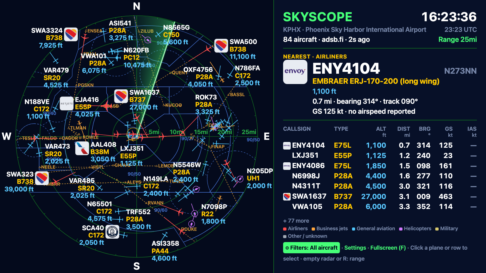

<p align="center"></p>

# SkyScope

**Designed and Created by Project Moon Pi**

A live ADS-B radar scope styled after an ATC display: aircraft from the
internet (adsb.fi) or your own SDR receiver, drawn over runways, airspace and
SID/STAR routes. It runs on a Raspberry Pi driving an HDMI monitor or TV, and
in any web browser (sharp on Retina and high-DPI screens).



- Python 3.10+ and pygame (or pygame-ce, its drop-in community edition); no other packages.
- Pi + HDMI: a fullscreen pygame display (tested at 1920×1080 and 1280×720).
- Browser: the same scope at `http://<address>:7700/radar`, from any device
  on your network, or alone on a laptop with `--web-only`.
- Settings page at `http://<address>:7700/radar_config`.

## Documentation

**[SkyScope Guide (PDF)](docs/SkyScope-Guide.pdf)**: requirements, step-by-step
Raspberry Pi installation, setup, every feature, and troubleshooting. The same
guide is built into the app at `http://<address>:7700/guide` (source:
[docs/guide.html](docs/guide.html); rebuild the PDF with
`sh tools/build_guide_pdf.sh`).

## Requirements (summary)

| | Raspberry Pi | Laptop / desktop |
|---|---|---|
| Hardware | Pi 5 (recommended) or Pi 4 (2 GB+), official power supply, 16 GB+ microSD, HDMI display | Any Mac, Windows or Linux computer |
| Software | Raspberry Pi OS with desktop (64-bit), `python3-pygame`, `git` | Python 3.10+, `pip3 install pygame-ce`, a current browser |
| Network | Internet for adsb.fi data, logos and photos; port 7700 on your LAN | Same |
| Optional | RTL-SDR dongle + 1090 MHz antenna (`readsb`); USB GPS (`gpsd`) | |

- **Radar scope** on the left, full screen height: range rings, ATC-style runways, aircraft
  symbols, speed lines, labels, and dots for traffic just beyond the range
- **Radar sweep**: a rotating beam with a fading green trail
- **Aircraft silhouettes** (optional): top-down airliner, wide-body, business
  jet, turboprop, light single, glider and helicopter shapes, picked from each
  aircraft's ADS-B category and type code, sized by class. Or the original red
  triangles.
- **Airline logos** (optional): from the callsign (KLM887 → KLM), on the
  Nearest card, in the table, and optionally beside the radar tags
- **Uncluttered labels**: nearest aircraft are labelled first; a label that
  would cover another label, an aircraft or a compass letter tries the other
  side, above and below, and is left off if none fit (the aircraft stays in
  the table)
- **Units of your choice**: distance km / mi / nm, speed kt / km/h / mph,
  altitude ft / m. Every figure is labelled with its unit.
- **Ground speed and airspeed**: GS plus TAS or IAS in the table; the Nearest
  card shows every speed the aircraft reports. Airspeeds come from Mode S
  "enhanced surveillance" replies, which are common for airliners in Europe
  and rare for light aircraft and in the US, so expect "—" for many aircraft.
- **Info panel** on the right: clock (local + UTC), aircraft count, a "Nearest"
  card (callsign, registration, aircraft name, altitude and climb/descent,
  distance, bearing, speed, track) and a table of contacts, nearest first. The
  nearest contact is ringed in yellow on the scope.
- Live data from [adsb.fi](https://opendata.adsb.fi/), polled every 5 s, with
  positions dead-reckoned between fetches so planes move smoothly
- Screens narrower than ~3:2 show the radar alone, centred

## Settings web page

Every option can be changed from a phone or laptop on the same network at
**`http://<pi-address>:7700/radar_config`** (the address is shown at the bottom
of the side panel). The page is arranged in tabs: **General** (location, data
source), **Display** (scope, units, sweep), **Map** (runways, airspace,
SIDs/STARs), **Filters**, **Presets**, **Alerts** and **About** (version,
this radar's addresses, links to the guide and the companion displays,
credits). Changes are kept until you press **Save** in the bar at the bottom,
which says when there are unsaved changes; saved changes apply to the screen
immediately.

Tip: name the Pi `skyscope` (Raspberry Pi Imager → hostname) and the page is
also at `http://skyscope.local:7700/radar_config`. The bare address
(`:7700`) opens the browser radar. The page has
no password, so anyone on your network can change settings. Set `web_port` to
0 in `settings.json` to turn it off.

## Filters: choose which aircraft appear

In the **Filters** section of the settings page. Filters apply to the radar,
the edge dots, the table and the Nearest card; while any is on, the panel says
e.g. "35 of 134 aircraft (filtered)".

- **Kinds of aircraft** (tick the ones to show). Every aircraft is in exactly one:
  - *Airliners*: jets, and turboprops flying an airline callsign
  - *Business jets*
  - *General aviation*: light aircraft and private turboprops (a Cessna on a
    flight school's callsign is still GA)
  - *Helicopters*
  - *Military*: flagged as military in the aircraft database
  - *Other / unknown*: no type information (e.g. TIS-B targets) and ground stations
- **Aircraft types**: ICAO type codes, *show only these* or *hide these*.
  `*` matches anything: `B73*` is every 737, `A32*` the A320 family.
- **Airlines / operators**: the three-letter code at the start of the callsign
  (`AAL`, `SWA`, `UAL`, `KLM` ...), show only or hide.
- **Country of registration**: tick countries, show only or hide. Worked out
  from each aircraft's 24-bit ICAO address (allocation table from ICAO Annex
  10, in `data/icao_countries.json`), so it works even without a registration.
- **Altitude blocks** (barometric altitude; also an **Altitude** dropdown on
  the radar page with All / each block / Below FL180 / Above 10,000 ft): *10,000 ft and below*, *10,001 ft
  to FL180*, *FL180 to FL600*; untick a block to hide it. Aircraft on the
  ground count as the lowest block; aircraft with no altitude are hidden while
  any block is off.
- **Presets**: built in are *Everything*, *Airliners only*, *GA & helicopters,
  10,000 ft and below*, *Helicopters* and *Military*. Set the filters you
  want and **Save preset** under your own name; **Apply** or **Delete** them on
  the settings page, or switch presets from the picker at the bottom of the
  radar page. The panel shows the active preset beside the range.

Watched aircraft and emergencies are always shown, whatever the filters.

## Alerts and colours

- **Emergency squawks**: aircraft squawking 7700 (emergency), 7600 (radio
  failure) or 7500 (hijack), or broadcasting an emergency status, flash
  red/white with a pulsing ring, are labelled first, go to the top of the
  table, and get a red banner in the panel.
- **Watchlist**: callsigns, registrations, ICAO addresses or type codes, with
  `*` wildcards (`N123AB`, `ENY*`, `B52`, `A0B1C2`). Matches get a gold ring,
  a ★ in the table and a gold callsign, are labelled first, and (optionally) a
  gold banner while in range.
- **Colour by kind**: airliners red, business jets orange, GA blue,
  helicopters purple, military khaki, other grey, with a key in the panel.
  Off: everything red.

The Nearest card also names the aircraft's kind (e.g. "NEAREST · AIRLINERS").

## Aircraft data: internet or your own receiver

Choose **Aircraft data from** on the settings page:

- **Internet (adsb.fi)**: the default. Needs a network connection; polled
  every 5 s.
- **SDR receiver on this Pi**: a USB RTL-SDR dongle with a 1090 MHz antenna,
  decoded by **readsb** (or **dump1090-fa** / PiAware). Works with no internet
  at all, refreshes every second, and shows what *your* antenna hears, so
  range depends on the antenna and its view of the sky.

The radar reads the decoder's `aircraft.json`. With the location left at
`auto` it finds readsb, dump1090-fa, dump1090 or a tar1090/SkyAware web page
by itself; otherwise enter the file path or URL. The settings page shows
which one it's reading, or why it can't. The side panel shows the source
("adsb.fi" or "SDR receiver") next to the aircraft count.

Installing readsb (the decoder) on the Pi:

```bash
sudo bash -c "$(wget -O - https://github.com/wiedehopf/adsb-scripts/raw/master/readsb-install.sh)"
sudo readsb-set-location <your-lat> <your-lon>
```

Note: with a local receiver, the aircraft type and full name come from the
decoder's aircraft database. If that isn't enabled, those fields may be
blank for some aircraft. Airline logos already downloaded keep working
offline; new ones need internet once.

## Location from GPS

With a GPS receiver attached, the radar can centre itself. Choose the
**Location source** on the settings page:

| Source | Use it for | Behaviour |
|--------|-----------|-----------|
| Manual | Typing the position in | Uses the latitude/longitude fields |
| GPS: read once at start-up | A Pi that stays put | Takes one fix each time it starts, then stays fixed. **Read GPS now** takes a fresh one (e.g. after moving it). |
| GPS: keep updating | A mobile Pi | Re-centres every *N* seconds (`gps_update_s`, default 30), ignoring moves under 50 m (GPS jitter) |

The panel shows **GPS** / **GPS live** next to the coordinates, or a red
"no fix, last known position" note. The settings page shows fix type and
satellite count. Every GPS position is saved, so after a reboot without a fix
the radar starts at the last known spot.

The GPS is read through **gpsd**, the standard Linux GPS service, so any
receiver gpsd supports works (USB sticks such as u-blox, or GPS HATs):

```bash
sudo apt install gpsd
# USB receivers are usually found automatically. For a HAT on the serial port,
# set DEVICES="/dev/serial0" in /etc/default/gpsd, then:
sudo systemctl restart gpsd
```

## Controls (USB keyboard, optional)

| Key | Effect |
|-----|--------|
| R / Space / → | Next range (see *Ranges* below) |
| ← | Previous range |
| U | Distance unit: km → mi → nm |
| W | Runways on/off |
| S | Sweep on/off |
| A | Aircraft symbols: silhouettes ↔ triangles |
| L | Airline logos: off → side panel only → panel + radar |
| G | Ground traffic on/off |
| D | Dots on the rim for aircraft just beyond the range on/off |
| F | Fullscreen ↔ window |
| Q / Esc | Quit |

All changes are saved.

### Ranges

The range is the distance to the outer ring, in round numbers for each
distance unit. Every ring is labelled with its distance (beside the east
spoke), at a round step: 25 mi → 5 / 10 / 15 / 20 / 25, 50 km → 10 … 50,
2 mi → 0.5 / 1 / 1.5 / 2.

| Unit | Ranges |
|------|--------|
| km | 5, 10, 15, 25, 50, 100, 150, 200, 300, 400 |
| mi | 2, 5, 10, 15, 25, 50, 75, 100, 150, 200, 250 |
| nm | 2, 5, 10, 20, 40, 60, 80, 100, 150, 200 |

Changing the unit moves to the nearest equivalent range (e.g. 50 km → 25 mi).
The largest ranges stay within adsb.fi's 250 nm query radius (the scope
fetches ~11% past its outer ring for the edge dots). They can be busy: around
Phoenix about 240 aircraft at 100 mi and 600 at 250 mi on a weekday
afternoon. Labels thin themselves out, every aircraft stays in the table, and
up to 1,500 aircraft are handled; filters help most here. The browser display
draws 500+ aircraft in under 10 ms per frame; on a Pi, the pygame display may
slow down at the largest ranges.

## Settings

Everything is stored in `settings.json` next to `skyscope.py` (created on
first run). The web page and keys edit it for you; by hand you can also set:

| Key | Default | Meaning |
|-----|---------|---------|
| `data_source` | `"internet"` | `"internet"` or `"sdr"` |
| `sdr_location` | `"auto"` | Path or URL of the decoder's aircraft.json |
| `distance_unit` | `"km"` | `"km"`, `"mi"` or `"nm"` |
| `speed_unit` | `"kt"` | `"kt"`, `"kmh"` or `"mph"` |
| `altitude_unit` | `"ft"` | `"ft"` or `"m"` (climb rate then in m/s) |
| `show_airspeed` | true | Airspeed alongside ground speed |
| `airspeed_type` | `"tas"` | Table column: `"tas"` (true) or `"ias"` (indicated) |
| `hidden_classes` | `[]` | Kinds to hide: `airliner`, `bizjet`, `ga`, `helicopter`, `military`, `other` |
| `type_mode` / `type_filter` | `"off"` / `""` | `"only"` or `"hide"`; codes like `"B738, A32*"` |
| `operator_mode` / `operator_filter` | `"off"` / `""` | `"only"` or `"hide"`; codes like `"AAL, SWA"` |
| `country_mode` / `country_filter` | `"off"` / `[]` | `"only"` or `"hide"`; country names |
| `show_airspace` | true | US Class B/C/D outlines |
| `procedure_airports` / `procedure_mode` | `{}` / `"both"` | Per airport, e.g. `{"KPHX": "star"}`; overall switch `both` (as ticked), `sid`, `star`, `off` |
| `runway_types` / `runway_centerlines` | `["L","M","S"]` / true | Airports shown (major/regional/small); ATC-style centrelines |
| `center_airport` | `""` | ICAO code the scope is centred on |
| `hidden_alt_bands` | `[]` | Altitude blocks to hide: `low`, `mid`, `high` |
| `filter_presets` | `{}` | Your saved presets: name → filter values |
| `highlight_emergencies` | true | Flash and banner 7500/7600/7700 |
| `watchlist` / `watch_notice` | `""` / true | Watched aircraft; banner when in range |
| `color_by_kind` | false | Colour symbols by kind of aircraft |
| `location_source` | `"manual"` | `"manual"`, `"gps_once"` or `"gps_live"` |
| `gps_update_s` | 30 | Seconds between GPS re-centres when mobile |
| `aircraft_symbol` | `"silhouette"` | `"silhouette"` or `"triangle"` |
| `airline_logos` | `"all"` | `"off"`, `"panel"` or `"all"` |
| `sweep_enabled` | true | Radar sweep on/off |
| `show_beyond_dots` | true | Rim dots for aircraft just outside the range |
| `web_port` | 7700 | Settings page port (0 = off) |
| `sweep_period_s` | 4.0 | Seconds per full turn of the beam |
| `sweep_trail_deg` | 90 | Length of the fading trail, in degrees |
| `fps` | 30 | Frame-rate cap; lower it if a Pi struggles |
| `fetch_interval_s` | 5 | ADS-B poll interval (adsb.fi allows 1 req/s) |

## Install on the Pi

Full steps, with screenshots, are in the [guide](docs/SkyScope-Guide.pdf).
In short, on Raspberry Pi OS with the desktop (set the hostname to `skyscope`
in Raspberry Pi Imager):

```bash
sudo apt update && sudo apt install -y python3-pygame git
git clone https://github.com/ricsne2010/skyscope.git ~/skyscope
python3 ~/skyscope/skyscope.py

# start on boot
mkdir -p ~/.config/autostart
sed "s#/home/pi#$HOME#" ~/skyscope/skyscope.desktop > ~/.config/autostart/skyscope.desktop
```

Then open `http://skyscope.local:7700/radar_config` from any device on your
network. Update later with `cd ~/skyscope && git pull`. If frames stutter on a
Pi 4, use filters or a shorter range, set the display to 1280×720, or lower
`fps` in `settings.json`.

## Browser display (sharp on any screen)

The radar can also be drawn by a web browser at **`http://<address>:7700/radar`**.
It's drawn at the screen's full resolution, so it's crisp on Retina and
scaled laptop screens where the pygame window looks soft. It fits any window
size; on a phone or a tall window the panel moves under the scope. It uses
the same data, units, symbols and logos as the pygame display, and follows the
settings page.

- **Click a plane** (its symbol or label) **or a row in the table** to select
  it: cyan brackets on the scope, its label outlined and always shown, its row
  highlighted, and the card shows its details as "SELECTED" instead of the
  nearest aircraft. Click it again, press **Esc** or the ✕ to clear. Hovering a
  table row briefly highlights that plane on the scope.
- **Flight route** on the card for airline flights (switch it off under
  *Display*): e.g. KPHX → KOAK · Phoenix → Oakland, from adsbdb.com by flight
  number. ADS-B carries no flight plan and flight numbers get reused, so a
  route shows only when it fits where the aircraft is; private and VFR
  flights have none.
- **Aircraft photo** beside the card (switch it off under *Display*): only a
  photo of that exact aircraft, from Planespotters.net, credited; clicking it
  opens the original page. Aircraft without one show a plane outline and
  "No image available" in the same box. The Pi display
  shows it too.
- **R** (or Space): next range; clicking the radar never changes it. **F**: fullscreen.
- **⚙ Filters** (bottom of the panel) opens a panel to pick any combination of
  kinds of aircraft and altitude blocks, a preset, and the SIDs/STARs switch.
  It applies at once; the button shows what's being shown (e.g.
  "Airliners · 10,000 ft and below").
- The pointer hides after 3 s, for a TV or kiosk.
- To run *only* the browser display (no pygame window), e.g. on a laptop:

```bash
python3 skyscope.py --web-only     # opens http://localhost:7700/radar
```

The pygame window and the browser display can run at the same time: any
device on the network can open `/radar` while the Pi drives the TV.

## Running on a laptop or desktop (Mac, Windows, Linux)

The same code runs anywhere Python 3.10+ and pygame do. On a computer, install
**pygame-ce**, the drop-in community edition of pygame: it has ready-made
packages for the newest Python versions, which classic pygame often doesn't yet. Download SkyScope
(`git clone https://github.com/ricsne2010/skyscope.git`, or **Code → Download
ZIP** and unzip it), then:

**Mac:** install Python from [python.org](https://www.python.org/downloads/),
then in Terminal, in the SkyScope folder:

```bash
python3 -m pip install pygame-ce
sh tools/make_mac_app.sh        # SkyScope and Stop SkyScope icons on your Desktop
```

**Windows 10/11:** install Python from [python.org](https://www.python.org/downloads/)
(tick **Add python.exe to PATH**), then double-click
**`tools\windows\create-shortcut.bat`** in the SkyScope folder. It installs
pygame-ce if needed and puts SkyScope and Stop SkyScope shortcuts on the
Desktop and in the Start menu. (If Windows warns about a downloaded file,
choose **More info → Run anyway**.)

Clicking the icon starts SkyScope in the background, if it isn't already
running, and opens the radar in your browser; clicking it again just opens
the radar. Output goes to `skyscope.log` in the SkyScope folder. To stop
SkyScope, click **Stop SkyScope**; only the computer it runs on can stop it. From a terminal instead, on any system:

```bash
python3 skyscope.py --web-only          # radar in your browser (sharpest); py on Windows
python3 skyscope.py --window 1280x720   # or a pygame window
```

Then open **http://localhost:7700/radar_config** (settings) in a browser on the same computer and
click **Use this computer's location**. The browser asks permission and
fills in your position from the operating system's location service (on a
laptop, worked out from nearby Wi-Fi; usually within a few hundred metres).
On a Mac, Location Services must be on for your browser (System Settings →
Privacy & Security → Location Services). The button only appears on
`localhost`: browsers don't share location with plain-http pages on other
devices, so on a Pi use GPS or type the position in.

**Sharpness on high-resolution laptop screens:** pygame can't draw at Retina
(Mac) or scaled-display (Windows) resolution, so the window is drawn at
standard resolution and the OS enlarges it, which looks slightly soft. A Pi on
an HDMI TV or monitor isn't affected: one drawn pixel is one screen pixel.

## Testing on a desktop

```bash
python3 skyscope.py --window 1280x720
python3 skyscope.py --window 1920x1080 --screenshot out.png --seconds 8
```

The Pi display opens with a three-second start-up screen (the Project Moon Pi
logo, version and credit) while the first aircraft load; any key skips it, and
`--no-splash` leaves it out (`--screenshot` always does).

## Airports and runways (ATC-style map)

Runways are drawn like an ATC video map: true length (and true width when
zoomed in), **extended centrelines** 10 nm out from each end of runways
5,000 ft and longer with a tick every nautical mile (longer every 5), runway
numbers at the thresholds when zoomed in, and airport codes (thinned out at
long ranges; overlapping codes are left off). On the settings page's **Map** tab:
**Airports shown**: *Major*, *Regional* and *Small (paved)*, each on or off,
and **Extended centrelines** on/off.

**Airspace (US)**: Class B, C and D outlines from the FAA's Class Airspace
data, in chart colours (B solid blue, C solid magenta, D dashed blue), with
each shelf's ceiling/floor in hundreds of feet (e.g. `90/30`) when zoomed in.

**SIDs and STARs (US)**: on the settings page's **Map** tab, every airport
with published procedures within reach of the scope is listed (largest first,
small fields included), each with its own **SIDs** and **STARs** tick boxes
and counts; **Add another airport** searches the rest. **Show** is an overall
switch on top: *As ticked below* / *SIDs only* / *STARs only* / *None* (also
in the radar page's Filters panel). Departures are drawn teal, arrivals amber, as
dashed routes with named fixes (△) and the procedure name. The settings page
says how many each airport has. Data: FAA CIFP; legs flown on a heading
("then vectors") have no fixed track, so a route starts or ends where
vectoring takes over. **Not for navigation.**

Map labels (fixes, shelves, airport codes) avoid each other; aircraft labels
are drawn over the map.

**Centre on an airport**: in the Location card (Manual source), search by
ICAO or IATA code or by name (`KDVT`, `PHX`, `Heathrow`) and pick a result;
the scope centres on it and the panel shows its name.

The data comes from [OurAirports](https://ourairports.com/data/) (public
domain): `data/airports.json` (about 9,700 airports with 12,000 runways) and
`data/airport_index.json` (about 48,000 airports for the search). Small
airfields are included when they have a paved runway of 2,000 ft or more with
a known position. To refresh:

```bash
python3 tools/build_airports.py     # airports and runways (OurAirports)
python3 tools/build_airspace.py     # US Class B/C/D (FAA)
python3 tools/build_procedures.py   # US SIDs/STARs (FAA CIFP, new cycle every 28 days)
```

## Airline logos

Logos are airlines' trademarks, so none are stored in this repo. The first time
an airline appears, its logo is downloaded from the
[Jxck-S/airline-logos](https://github.com/Jxck-S/airline-logos) collection into
`logos_cache/` and reused from then on (airlines with no logo are remembered in
`logos_cache/missing.txt`). To use your own artwork, put a PNG named after the
ICAO airline code in `logos/` (e.g. `logos/KLM.png`); it takes priority.
Logos sit on a light tile so dark logos stay readable on the dark screen.

## Companion displays: SkyScope Satellite and Mini

Both run on a 4.3″ ESP32-S3 touch display (Sunton ESP32-8048S043, 800×480):

- **[SkyScope Satellite](https://github.com/ricsne2010/skyscope-satellite)**: a
  second screen for this SkyScope. It reads `/api/satellite` and shows the same
  radar, range, filters and map. Point it at `skyscope.local` (name the Pi
  `skyscope`) or at the address on the settings page's **About** tab.
- **[SkyScope Mini](https://github.com/ricsne2010/skyscope-mini)**: a small
  standalone radar that fetches adsb.fi itself; no Pi needed.

## Credits and data

SkyScope grew out of [ESP32-Plane-Radar](https://github.com/MatixYo/ESP32-Plane-Radar)
by MatixYo (MIT licence), a radar for a 1.28″ round display on an ESP32; its
scope design, range presets and colours were the starting point.

| Data | Source | Terms |
|------|--------|-------|
| Live aircraft | [adsb.fi](https://adsb.fi/) open data API, or your own readsb/dump1090 receiver | adsb.fi's API terms (public limit 1 request/s) |
| Airports, runways, airport search | [OurAirports](https://ourairports.com/data/) | Public domain |
| Class B/C/D airspace (US) | FAA Class Airspace open data | Public domain |
| SIDs and STARs (US) | FAA CIFP (Coded Instrument Flight Procedures) | Public domain |
| Country from ICAO address | ICAO Annex 10 Vol III allocation table (via tar1090) | Facts |
| Airline logos | Downloaded at run time from [Jxck-S/airline-logos](https://github.com/Jxck-S/airline-logos); not stored in this repo | Airlines' trademarks |
| Aircraft photos | [Planespotters.net](https://www.planespotters.net/) photo API, exact aircraft only; shown from their servers, never stored | Photographers' copyright; shown with credit and link, per Planespotters' API terms |
| Flight routes | [adsbdb.com](https://www.adsbdb.com/) callsign API: the published route of an airline flight number, shown only when it fits the aircraft's position | Free community data |

| Software | Source | Licence |
|----------|--------|---------|
| Language and display | [Python](https://www.python.org) and [pygame](https://www.pygame.org) / [pygame-ce](https://pyga.me) | PSF; LGPL 2.1 |
| Built with | [Claude Code](https://claude.com/claude-code) (Anthropic): designed, written and tested with Claude | |

**Not for navigation.** Map layers are approximations for watching traffic;
procedure routes skip legs flown on a heading, and arcs are drawn as chords.

## Licence

MIT; see [LICENSE](LICENSE).
